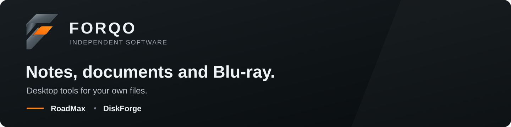

# FORQO

[English](#english) · [Русский](#русский)

## English

Max Liv develops RoadMax and DiskForge Studio under the FORQO name. Both applications work with files on your own computer and offer English and Russian interfaces.

### RoadMax

Keep project notes on the same board as the documents they refer to. Pin a source PDF, annotate a passage, and draw an arrow to the note it supports. You can also work with images and supported spreadsheets and Word documents. To take a board to another computer, export its project folder with the attachments.

Available for **Windows 10/11 x64** and **macOS 13 or later** on Apple Silicon and Intel. [Download RoadMax](https://roadmax.dskforge.com/#download) · [English overview and sample board](https://github.com/FORQO/RoadMax-Public/blob/main/README.en.md) · [Latest release](https://github.com/FORQO/RoadMax-Public/releases/latest)

### DiskForge Studio

Turn films or episodes into a Full HD Blu-ray with a menu you design. Choose chapters, audio tracks and subtitles, preview the navigation, then export a BDMV folder or ISO image. To put the result on a blank disc, burn the exported image with a separate disc-writing program.

Available for **Windows 10/11 x64** and **Macs with Apple Silicon**. The application source is published under the MIT license. [Download DiskForge Studio](https://github.com/FORQO/DiscForge-RU/releases/latest) · [English guide and screenshots](https://github.com/FORQO/DiscForge-RU/blob/main/docs/STUDIO_EN.md) · [Player compatibility tests](https://github.com/FORQO/DiscForge-RU/blob/main/docs/PLAYER_TEST_MATRIX.md)

## Русский

FORQO — проекты независимого разработчика Max Liv. Оба приложения работают с файлами на вашем компьютере и доступны на русском и английском.

### RoadMax — доска для материалов проекта

Держите заметки рядом с документами, к которым они относятся. Можно закрепить PDF, отметить в нём нужный фрагмент и соединить его стрелкой с выводом на стикере. RoadMax также работает с изображениями, таблицами и поддерживаемыми документами Word. Для переноса на другой компьютер экспортируйте папку проекта вместе с вложениями.

Доступен для **Windows 10/11 x64** и **macOS 13 и новее** на Apple Silicon и Intel. [Скачать RoadMax](https://roadmax.dskforge.com/#download) · [Пример доски](https://github.com/FORQO/RoadMax-Public/raw/refs/heads/main/examples/one-street-ru.zip) · [Краткая инструкция](https://github.com/FORQO/RoadMax-Public/blob/main/docs/QUICK-START-RU.md)

### DiskForge Studio — создание Blu-ray

Соберите фильмы или серии на одном Full HD Blu-ray. Настройте меню, главы, аудиодорожки и субтитры, проверьте навигацию в предпросмотре и экспортируйте папку BDMV или ISO-образ. Готовый образ можно записать на диск отдельной программой.

Доступен для **Windows 10/11 x64** и **Mac с Apple Silicon**. Исходный код приложения опубликован под лицензией MIT. [Скачать DiskForge Studio](https://github.com/FORQO/DiscForge-RU/releases/latest) · [Руководство](https://github.com/FORQO/DiscForge-RU/blob/main/docs/USER_GUIDE.md) · [Проверка на плеерах](https://github.com/FORQO/DiscForge-RU/blob/main/docs/PLAYER_TEST_MATRIX.md)

## Feedback / Обратная связь

[RoadMax](https://github.com/FORQO/RoadMax-Public/issues) · [DiskForge Studio](https://github.com/FORQO/DiscForge-RU/issues) · [FORQO](https://github.com/FORQO/FORQO/issues)

[Contributing / Участие](CONTRIBUTING.md) · [Code of conduct / Кодекс поведения](CODE_OF_CONDUCT.md) · [Security / Безопасность](SECURITY.md)
