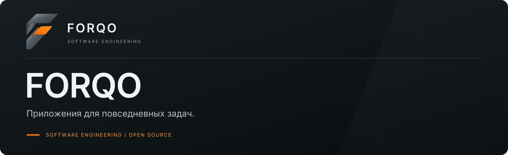

  

<b>Разработка ПО, открытый код и русскоязычные интерфейсы.</b>

<a href="#о-forqo">О FORQO</a> · <a href="#проекты">Проекты</a> · <a href="#технологии">Технологии</a> · <a href="#принципы-разработки">Принципы</a> · <a href="#обратная-связь">Обратная связь</a>

| Платформа / направление | Статус | Технологии |
| :--- | :--- | :--- |
| Desktop-приложения | Открытая разработка | Python · Swift · Rust |

---

## О FORQO

FORQO — бренд разработки программного обеспечения. Здесь собраны desktop-приложения и русскоязычные модификации открытых проектов: видео, личные финансы и работа с PDF.

За проектами — **Max Liv**. В фокусе — понятные интерфейсы, практические задачи и открытая разработка.

## Проекты

| Проект | Задача | Платформа · статус |
| :--- | :--- | :--- |
| **[DiscForge RU](https://github.com/FORQO/DiscForge-RU)** | Подготовка видео к Blu-ray: анализ, главы, BDMV и ISO. | Windows · macOS экспериментально · **альфа** |
| **[FinTrack Mac](https://github.com/FORQO/FinTrack)** | Личные финансы: счета, категории, дашборд, RUB / USD / EUR и курсы ЦБ РФ. Русскоязычная модификация Mint Leaf. | macOS · Apple Silicon · **в разработке** |
| **[PdfCraft RU](https://github.com/FORQO/pdfcraft)** | Работа с PDF и развитие русскоязычного интерфейса. Независимый форк проекта ArtCraft / storytold. | Rust · egui · **в разработке** |

## Технологии

**Python · PySide6 · FFmpeg**
Видео, desktop-интерфейсы и инструменты для Blu-ray.

**Swift · SwiftUI · SwiftData**
Приложения для macOS.

**Rust · egui**
Инструменты для работы с PDF.

## Принципы разработки

- **Понятный интерфейс.** Сценарии для повседневных задач.
- **Прозрачный статус.** Требования, запуск и ограничения — в репозиториях.
- **Уважение к открытому коду.** Ссылки на исходные проекты, лицензии и авторство сохраняются.

## Обратная связь

Ошибки и предложения — через **Issues** соответствующего проекта. Укажите версию приложения, операционную систему и шаги воспроизведения. Примеры и файлы присылайте без личных данных.

Обучение и достижения автора

[Introduction to Cybersecurity — Cisco](https://www.credly.com/earner/earned/badge/f3bd5265-cc8e-482c-ad35-71eb23c43f47) — курс Cisco Networking Academy, бейдж выдан 16 октября 2026 года.

## Участие

[Как внести вклад](CONTRIBUTING.md) · [Кодекс поведения FORQO](CODE_OF_CONDUCT.md).

---

<a href="https://github.com/FORQO"><b>FORQO</b></a> · SOFTWARE ENGINEERING Desktop applications · Open source · RU interfaces

